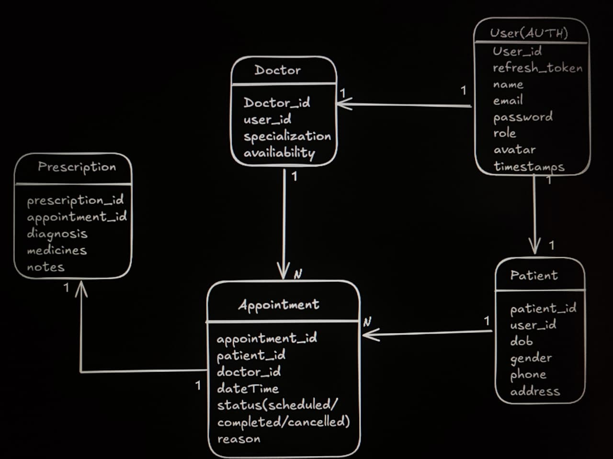

# Hospital Management System Backend

This is my first independent backend project. I built this from scratch to truly understand core backend architecture, routing, and database modeling. While I used AI as a mentor to ask conceptual questions and figure out how things work, every line of code was written and understood by me—no copy-pasting.

## 🚀 Core Focus & What I Learned

1. **MongoDB Connection Architecture**: Handled the MongoDB URI setup and database connection logic cleanly in a separate directory (`src/db/index.js`), ensuring the server connects successfully before listening for incoming requests.
2. **Secure File Upload Pipeline (Multer + Cloudinary)**: Built a complete two-step file upload system. Files are first saved temporarily on the local machine using `multer`. They are then uploaded to Cloudinary. Finally, Node's `fs.unlinkSync` is used to delete the temporary file from the local PC to prevent storage leaks, regardless of whether the cloud upload succeeds or fails.
3. **Headless API Testing**: There is no frontend for this project. The entire REST API was rigorously tested using Postman to ensure all routes, authentication gates, and data models work flawlessly.

## 🛠️ Tech Stack
* **Node.js & Express.js** - Server and routing
* **MongoDB & Mongoose** - Database and object data modeling
* **Cloudinary & Multer** - Media storage and local file handling pipeline
* **JWT & bcrypt** - Secure authentication and password hashing
* **Postman** - Comprehensive API testing

## 📦 Database Models & Entities

The database layer uses Mongoose schemas structured to maintain clear relationships:
* **User**: Manages authentication, identity, and access/refresh tokens.
* **Doctor**: Clinical profiles, qualifications, and department specializations.
* **Patient**: Medical histories, demographic details, and assigned records.
* **Appointment**: Connects patients to doctors with lifecycle statuses (`scheduled`, `completed`, `cancelled`).
* **Prescription**: Prescribed medications and relational links to the relevant doctor and patient.

### Entity Relationship Diagram


## 💻 How to Run Locally

1. **Clone the repository:**
   ```bash
   git clone <your-repo-link>
   cd Hospital-Management-Backend
   ```

2. **Install dependencies:**
   ```bash
   npm install
   ```

3. **Set up environment variables:**
   Create a `.env` file in the root directory based on `.env.sample`:
   ```env
   PORT=8000
   MONGODB_URI=<your_mongo_db_uri>
   CORS_ORIGIN=*
   ACCESS_TOKEN_SECRET=<your_access_secret>
   ACCESS_TOKEN_EXPIRY=1d
   REFRESH_TOKEN_SECRET=<your_refresh_secret>
   REFRESH_TOKEN_EXPIRY=10d
   CLOUDINARY_CLOUD_NAME=<your_cloud_name>
   CLOUDINARY_API_KEY=<your_api_key>
   CLOUDINARY_API_SECRET=<your_api_secret>
   ```

4. **Start the server:**
   ```bash
   npm run dev
   ```

## 🔗 API Structure (Tested via Postman)

All core routes are prefixed with `/api/v1/`:
* `/api/v1/users` - Registration, login, logout, and token refresh
* `/api/v1/doctors` - Doctor profiles and directory
* `/api/v1/patients` - Patient registration and records
* `/api/v1/appointments` - Appointment scheduling and status updates
* `/api/v1/prescriptions` - Medical prescriptions and instructions
